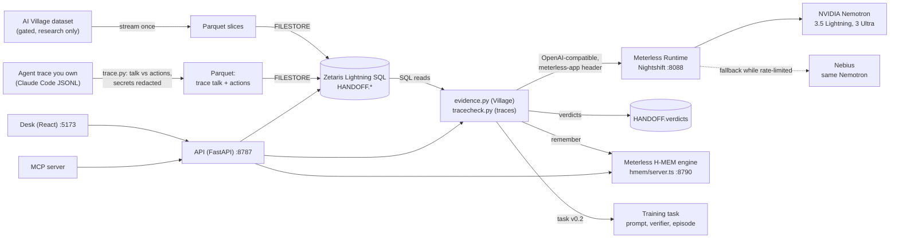

# Architecture

Handoff has one idea: an agent's words are not evidence, its actions are. Everything below exists to put a promise next to the actions that follow it, ask a judge model for a verdict with cited action ids, and keep that verdict open to correction.

It runs on one machine: Zetaris in Docker, Meterless Nightshift as the model runtime, the Meterless H-MEM engine as memory, a Python API and a React desk.

## Village investigation

| Step | What happens | Where |
|---|---|---|
| 1. Slice | Three Village weeks stream once from the gated dataset: chat, computer-use turns, memory notes. Only the rows for those weeks are kept, as Parquet. | `fetch.py`, `slice.py`, `turns.py`, `memories.py` |
| 2. Register | The Parquet files are copied into the Zetaris driver's file store and registered as FILESTORE tables. | `register.py`, `sql/01_handoff_filestore.sql` |
| 3. Candidates | `SELECT … FROM HANDOFF.promises`; a first-person pattern ("I'll", "let me", "on it") keeps 1,582 candidate lines. | `evidence.candidates`, `patterns.py` |
| 4. Extract | Nemotron 3.5 Lightning decides whether each line commits the speaker to a concrete task and names it (895). | `evidence.extract` |
| 5. Owner check | Nemotron 3 Ultra checks the task is the speaker's own, not another agent's (256 removed, 639 left). | `evidence.owner_check` |
| 6. Judge | The speaker's actions in the next 24 hours come from `HANDOFF.cu_turns` (later chat too). The 14 best matches go to Ultra, which answers kept, partial, not done or unclear, citing action ids. Narration is context, never proof. | `evidence.turns_for`, `rank`, `judge_window` |
| 7. Second look | Every not done is judged again with 60 actions (changed 74 of 217). | `second_look.py` |
| 8. Publish | Verdicts are written back as `HANDOFF.verdicts`; the desk, the MCP server and the explanation read the same rows. | `village.publish`, `village.rows` |
| 9. Remember | Each verdict goes into H-MEM with the promise id and cited action ids as provenance. | `village.remember_all`, `hmem.py` |
| 10. Explain | Ultra writes one paragraph on why work slipped, from the verdict table only, citing promise ids. | `village.why` |

## Trace into training task

| Step | What happens | Where |
|---|---|---|
| 1. Read | A Claude Code session splits into talk (the agent's text and the messages it sends) and actions (each tool call with its result). A plain chat export is talk only. Every string passes through the secret redactor. | `trace.parse`, `secrets.redact` |
| 2. Store | Talk and actions become two Parquet FILESTORE tables in Zetaris and are read back through SQL. If Zetaris is down, grading runs from memory and the task records `store: memory` and why. | `tracecheck.store` |
| 3. Extract | Lines by agents whose actions we have, phrased like work still to do, go to Lightning, which lists each commitment (one line can hold several). Conditional offers ("if requested") are dropped by prompt and by a regex. | `tracecheck.candidates`, `extract_all`, `CONDITIONAL` |
| 4. Judge | Ultra judges each promise against the same agent's later actions and chat: the actions right after the promise plus the best keyword matches. Nothing after the promise in the trace means unclear. | `tracecheck._judge`, `evidence.rank(first=…)` |
| 5. Second look | Every not done is judged again with 60 actions, the 20 right after the promise always among them. | `tracecheck.second_look` |
| 6. Export | Task v0.2: prompt, verifier rubric (verdict, reward, cited actions, reason, receipt per promise), and an episode of talk and actions in time order. Rewards: kept +1, partial +0.25, not done −1, unclear unscored (`handoff-reward@0.2`). The finished task is checked for secrets again. | `task.build_task`, `env_export.evidence_episode` |

## Model calls

All calls go through `handoff/llm.py` to the Meterless Runtime (Nightshift, `127.0.0.1:8088/v1`, proxy token, `meterless-app: handoff`).

| Step | Model | Notes |
|---|---|---|
| extract | `nvidia/nemotron-3.5-lightning-30b-a3b` | thinking off; JSON only |
| judge, owner check, second look, why | `nvidia/nemotron-3-ultra-550b-a55b` | thinking on; reasoning text is stripped before parsing |

- Every answer carries a signed `meterless.compute_receipt.v1`; the receipt id, routed model and timing are stored with the verdict.
- Calls are paced under `HANDOFF_RPM` (default 30 per minute) across threads.
- If Nightshift refuses connections, Meterless is skipped for 60 s (circuit breaker), and the same Nemotron model on Nebius answers if a key is set. The verdict records the route (`meterless` or `nebius-fallback`). `HANDOFF_NO_FALLBACK=1` disables the fallback.
- A private path (`meterless/local`) only sends text when a probe's receipt proves a local lane answered; otherwise it refuses.

## Storage

| Table | Rows | Source |
|---|---:|---|
| `HANDOFF.promises` | 9,614 | Village chat |
| `HANDOFF.cu_turns` | 213,113 | Village computer actions |
| `HANDOFF.memories` | 15,372 | Village memory notes |
| `HANDOFF.verdicts` | 639 | Handoff's verdicts |
| `HANDOFF.trace_<name>_<id>_talk` / `_actions` | per trace | an uploaded trace |

H-MEM keeps its own store behind `hmem/server.ts`; `.handoff/hmem_index.json` maps promise ids to memory ids.

## Interfaces

- **Desk** (`frontend/`): `/` landing, `/desk` investigation, evidence columns, Confirm / Mark wrong, Build task.
- **API** (`handoff/app.py`): `/api/health`, `/api/demo`, `/api/turns`, `/api/memory_note`, `/api/feedback`, `/api/audit`, `/api/investigate`, `/api/task`, `/api/sample`, `/api/catalog`.
- **MCP** (`handoff/mcp_server.py`): `handoff_demo`, `handoff_cited_actions`, `handoff_investigate`, `handoff_open_promises`, `handoff_improve`, `handoff_build_task`.
- **CLI**: `python -m handoff.tracecheck <trace> --name …`, `python -m handoff.hmem`.

## When things fail

| Failure | What happens | Where |
|---|---|---|
| Zetaris is down | `/api/health` reports it and the Village desk cannot load. Trace grading falls back to memory and the task says `store: memory` with the reason. | `app.health`, `tracecheck.store` |
| Nightshift is down | Meterless is skipped for 60 s and Nebius answers if configured; each verdict records its route. A trace export where every call failed is refused (HTTP 503), never exported empty. The desk nav shows "Meterless off". | `llm.chat`, `task._evidence_task` |
| NVIDIA rate-limits (429, sent back as 502 `nvidia_429`) | Pacing and backoff, then the fallback unless `HANDOFF_NO_FALLBACK=1`. | `llm._pace`, `llm.chat` |
| The judge's reply is not JSON | Asked twice; then the call counts as failed. Traces retry it once more and mark it `error`: never scored, never shown as unclear. | `evidence.judge_window`, `tracecheck.grade` |
| The judge misses the evidence | Every not done gets a second look with 60 actions; in traces the actions right after the promise are always shown. A reviewer can still mark the verdict wrong in H-MEM. | `second_look.py`, `tracecheck.second_look` |
| H-MEM helper is down | Remember and recall report "not running"; nothing is written anywhere else instead. | `hmem.py` |
| A trace contains secrets | Each string is redacted on the way in and the finished task is checked again; a raw chat transcript with secrets is refused. Pattern matching, not a guarantee. | `secrets.py` |
| Village data in a task | Never listed for sale; names containing "village" or "aidigest" turn the listing off. | `task.py`, `catalog.py` |

## Tests

- `python -m unittest discover -s tests`: 18 tests for the trace reader, redaction, rewards, verifier and episode, ranking, the conditional filter, and the chat-only path.
- `cd hmem && npm test`: the H-MEM reference engine's own suite (10 of 10).
- Live: `python -m handoff.hmem` (engine health, a recall, one verdict's ledger) and `python -m handoff.tracecheck fixtures/claude-code-trace.jsonl` (2 kept, 1 not done, every call with a Meterless receipt).

## Code map

| Path | Role |
|---|---|
| `handoff/zetaris.py` | Lightning SQL over REST |
| `handoff/llm.py` | Meterless Runtime client: steps, pacing, circuit breaker, fallback, receipts |
| `handoff/evidence.py`, `second_look.py`, `village.py` | Village investigation, publish, remember, explain |
| `handoff/trace.py`, `tracecheck.py` | Trace reader and trace grader |
| `handoff/task.py`, `env_export.py` | Training task and episode export |
| `handoff/hmem.py`, `hmem/server.ts` | H-MEM client and helper around the reference engine |
| `handoff/secrets.py` | Redaction and the export check |
| `handoff/app.py`, `mcp_server.py`, `frontend/` | API, MCP server, desk |
